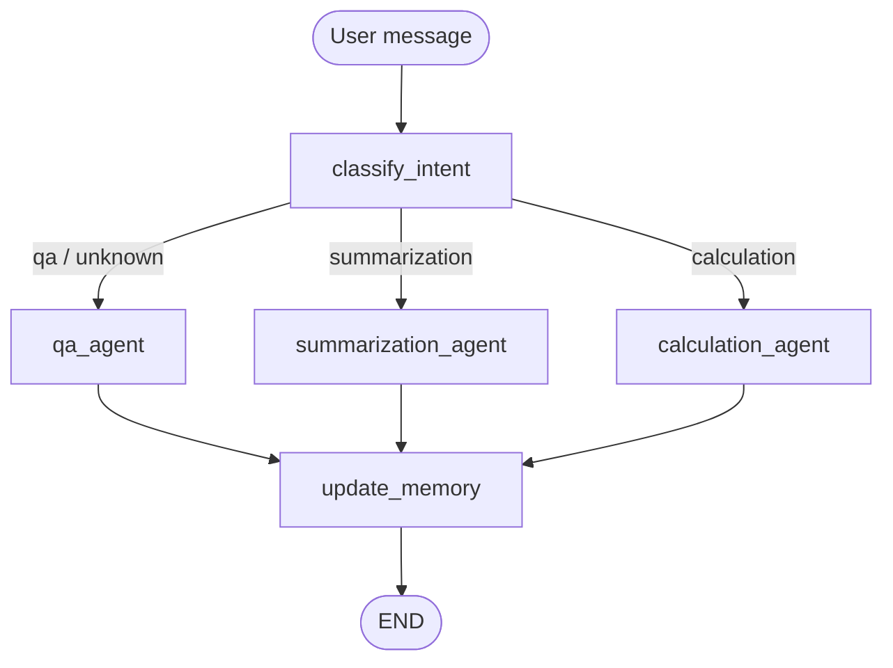

# Intelligent Document Assistant

A multi-intent document assistant built with **LangGraph**, **LangChain** and **OpenAI**. It classifies what the user wants (Q&A, summarization or calculation), routes the request to a specialised tool-using agent, returns a **schema-validated structured response**, and keeps a **running memory** of the conversation and the documents in play.

## Contents

- [Intelligent Document Assistant](#intelligent-document-assistant)
  - [Contents](#contents)
  - [Quick start](#quick-start)
    - [Configuration](#configuration)
    - [CLI commands](#cli-commands)
    - [Project layout](#project-layout)
  - [Architecture](#architecture)
  - [State and memory](#state-and-memory)
  - [Structured outputs](#structured-outputs)
  - [Tools](#tools)
  - [Design decisions](#design-decisions)
  - [Example conversations](#example-conversations)
    - [1. Single-document lookup](#1-single-document-lookup)
    - [2. Summarization](#2-summarization)
    - [3. Multi-document calculation](#3-multi-document-calculation)
    - [4. Memory-driven follow-up](#4-memory-driven-follow-up)
    - [5. Intent switching within one session](#5-intent-switching-within-one-session)
  - [Logging](#logging)

---

## Quick start

**Requirements:** Python 3.13+ and an OpenAI-compatible API key.

```bash
uv sync                          # or: pip install -e .
cp _env.example .env             # then add your API key
python main.py
```

### Configuration

`_env.example` ships with these settings:

```ini
# OpenAI API Configuration
OPENAI_API_KEY=your_openai_api_key_here

# Optional: Model Configuration
MODEL_NAME=gpt-4o
TEMPERATURE=0.1

# Optional: Session Storage
SESSION_STORAGE_PATH=./sessions
```

| Variable | Required | Default | Notes |
|---|---|---|---|
| `OPENAI_API_KEY` | Yes | none | Read in `main.py`; the app exits with an error if missing |
| `MODEL_NAME` | No | `gpt-4o` | Matches the value passed to `DocumentAssistant` |
| `TEMPERATURE` | No | `0.1` | Low for deterministic document work |
| `SESSION_STORAGE_PATH` | No | `./sessions` | Where session JSON files are written |

> Currently only `OPENAI_API_KEY` is read from the environment. The three optional values mirror the defaults hard-coded in `main.py` and `assistant.py`. To make them configurable, read them with `os.getenv(...)` in `main.py` and pass them to `DocumentAssistant`.

`assistant.py` also sets `base_url="https://openai.vocareum.com/v1"`. Change or remove it if you use OpenAI directly.

### CLI commands

| Command | Action |
|---|---|
| `/help` | Show commands and example queries |
| `/docs` | List all loaded documents |
| `/quit` | Exit |

### Project layout

```
main.py            # interactive CLI
src/
  assistant.py     # sessions, LLM setup, process_message()
  agent.py         # AgentState, graph nodes, create_workflow()
  prompts.py       # intent, per-agent and memory prompts
  schemas.py       # Pydantic response models
  tools.py         # calculator, search, reader, statistics + ToolLogger
  retrieval.py     # in-memory sample documents and retrieval
logs/              # tool-call logs
sessions/          # one JSON file per session
```

---

## Architecture



| Node | What it does |
|---|---|
| `classify_intent` | Calls the LLM with `with_structured_output(UserIntent)` and sets `next_step`. `unknown` falls back to `qa_agent` |
| `qa_agent`, `summarization_agent`, `calculation_agent` | Render the intent-specific prompt with chat history, run a ReAct agent (`create_agent`) with tools and a `response_format` schema |
| `update_memory` | Summarises the conversation and extracts the relevant document IDs via `with_structured_output(UpdateMemoryResponse)` |

The `calculation` intent is deliberately broad ("numerical computations, or questions about documents that may require calculations"), so numeric questions such as "total of invoice INV-001" or "most lucrative contract" go to the agent whose prompt requires the calculator.

---

## State and memory

`AgentState` is a `TypedDict`. Each node returns a partial update that LangGraph merges using each key's reducer.

| Key | Reducer | Purpose |
|---|---|---|
| `messages` | `add_messages` | Full conversation including tool calls and results |
| `actions_taken` | `operator.add` | Append-only trace of nodes executed |
| `intent`, `next_step` | overwrite | Classification result and routing signal |
| `conversation_summary`, `active_documents` | overwrite | Output of `update_memory` |
| `current_response` | overwrite | Agent result: `{"messages": [...], "structured_response": <Pydantic object>}` |
| `tools_used`, `user_input`, `session_id`, `user_id` | overwrite | Per-turn and session metadata |

`actions_taken` shows the route taken across the whole thread, for example after two turns:

```
['classify_intent', 'calculation_agent', 'classify_intent', 'calculation_agent']
```

**Three layers of memory**

| Layer | Lives in | Holds |
|---|---|---|
| Graph state | `InMemorySaver`, keyed by `thread_id` = session ID | Full message history; lets follow-ups resolve against earlier turns |
| Conversation summary | `state["conversation_summary"]` | LLM-written recap refreshed every turn |
| Session file | `./sessions/<session_id>.json` | Per-turn state snapshots and accumulated `document_context` |

The checkpointer's msgpack serialiser uses an explicit allow-list: a `@register_schema` decorator in `schemas.py` records each model, and `create_workflow` passes the list to `JsonPlusSerializer(allowed_msgpack_modules=...)`.

---

## Structured outputs

| Schema | Used by | Key fields |
|---|---|---|
| `UserIntent` | `classify_intent` | `intent_type` (`Literal["qa","summarization","calculation","unknown"]`), `confidence`, `reasoning` |
| `AnswerResponse` | `qa_agent` | `question`, `answer`, `sources`, `confidence`, `timestamp` |
| `SummarizationResponse` | `summarization_agent` | `summary`, `key_points`, `document_ids`, `original_length` |
| `CalculationResponse` | `calculation_agent` | `expression`, `result: float`, `explanation`, `units` |
| `UpdateMemoryResponse` | `update_memory` | `summary`, `document_ids` |

Enforcement happens at three levels:

1. **Typed schemas** with `Field(description=...)`. The descriptions are sent to the model as per-field instructions.
2. **Schema-bound calls.** Single-shot nodes use `with_structured_output`; agents use `create_agent(..., response_format=Schema)`. For agents, the schema is exposed as a final tool call named after the model. The framework validates it and stores the object under `structured_response`.
3. **Defensive routing.** The router has a `case _:` fallback to `qa_agent`.

Example classifier output from a real run:

```json
{"intent_type": "calculation", "confidence": 0.95,
 "reasoning": "The user's request explicitly asks for a calculation ('Calculate the sum'), which involves mathematical operations on numerical data ('invoice totals')."}
```

In every recorded turn, responses parsed into their schema, with `result` a real `float` and `key_points` a list of strings.

---

## Tools

| Tool | Purpose |
|---|---|
| `calculator(expression)` | Evaluates arithmetic. A regex allow-list (`digits . + - * / ( )`) runs before `eval`, which also has `__builtins__` disabled. Every call is logged |
| `document_search(...)` | Keyword, type, or amount search (`over`, `under`, `between`, `exact`, `approximate`) |
| `document_reader(doc_id)` | Returns the full text of one document |
| `document_statistics()` | Counts by type plus total, average, min and max amounts |

**Sample data**

| ID | Type | Amount |
|---|---|---|
| `INV-001` | invoice (Acme) | no stored total; subtotal $20,000 + tax $2,000 |
| `INV-002` | invoice (TechStart) | $69,300 |
| `INV-003` | invoice (Global Corp) | $214,500 |
| `CON-001` | contract (Healthcare Partners) | $180,000 |
| `CLM-001` | claim (John Doe) | $2,450 |

---

## Design decisions

- **LangGraph graph over a single agent.** Focused prompts per intent and an inspectable control flow; every path ends in `update_memory`.
- **One schema per intent.** A calculation needs an auditable `expression` and numeric `result`; a summary needs `key_points`; an answer needs `sources`.
- **Calculator for all arithmetic.** Keeps numbers traceable in the tool log.
- **Reducers where it matters.** `add_messages` for history, `operator.add` for the action trace.
- **Allow-listed serialisation.** Only the project's own types are deserialised from checkpoints.
- **Simulated retriever.** Deterministic and dependency-free, since the project focuses on agent behaviour rather than embedding quality.
- **Dependencies injected through `config["configurable"]`** (`thread_id`, `llm`, `tools`), so nodes are pure functions of `(state, config)`.
- **Low temperature (0.1)** for repeatable document work.

---

## Example conversations

Rendered from the recorded session files and tool logs (three sessions, `gpt-4o`). Responses are the saved final message of each turn, so they appear as the structured-response text.

### 1. Single-document lookup

```
Enter Message: What's the total amount in invoice INV-001?

🤖 Assistant: Returning structured response: expression='20000 + 2000' result=22000.0
explanation='The total amount in invoice INV-001 is calculated by adding the subtotal
of $20,000 and the tax of $2,000.' units='USD' ...

INTENT: calculation
```
**Tools:** `document_reader(INV-001)` → `calculator("20000 + 2000")`

Routed to the calculation agent because the invoice shows no total. The agent went straight to the reader because the question named the document ID.

### 2. Summarization

```
Enter Message: Summarize all contracts

🤖 Assistant: Returning structured response: original_length=498
summary='The Service Agreement (ID: CON-001) is a contract between DocDacity Solutions
Inc. and Healthcare Partners LLC, effective from January 1, 2024. It includes services
such as access to a document processing platform, 24/7 technical support, monthly data
analytics reports, and compliance monitoring. The contract is valued at $180,000 over a
12-month period, with a monthly fee of $15,000. Either party can terminate the agreement
with a 60-day written notice.'
key_points=['Contract ID: CON-001',
  'Parties: DocDacity Solutions Inc. and Healthcare Partners LLC',
  'Effective Date: January 1, 2024', 'Duration: 12 months',
  'Monthly Fee: $15,000', 'Total Value: $180,000',
  'Termination: 60 days written notice', ...]
document_ids=['CON-001'] ...

INTENT: summarization
```
**Tools:** `document_search(type=contract)` → `document_reader(CON-001)`

The same search-then-read pattern appeared in two independent sessions.

### 3. Multi-document calculation

```
Enter Message: Calculate the sum of all invoice totals

🤖 Assistant: Returning structured response: expression='22000 + 69300 + 214500'
result=305800.0 explanation='The sum of all invoice totals is calculated by adding the
total amounts from each invoice. Invoice #12345 has a total of $22,000, Invoice #12346
has a total of $69,300, and Invoice #12347 has a total of $214,500. Adding these amounts
together gives $22,000 + $69,300 + $214,500 = $305,800.' units='USD' ...

INTENT: calculation
CONVERSATION SUMMARY: The user requested the sum of all invoice totals. Three invoices
were identified: Invoice #12345 with a total of $22,000, Invoice #12346 with a total of
$69,300, and Invoice #12347 with a total of $214,500. The sum of these invoices was
calculated to be $305,800.
```
**Tools:** `document_statistics` → `document_search(type=invoice)` → 3 × `document_reader` (in parallel) → `calculator("22000 + 69300 + 214500")`

Shows a full multi-tool chain ending in a calculator call, with the memory node recording the result.

### 4. Memory-driven follow-up

Continuing the conversation above:

```
Enter Message: What's the total amount in invoice INV-001?

🤖 Assistant: Returning structured response: expression='20000 + 2000' result=22000.0
explanation='The total amount for invoice INV-001 is calculated by adding the subtotal
and the tax. The subtotal is $20,000 and the tax is $2,000. Therefore, the total amount
is $20,000 + $2,000 = $22,000.' units='USD' ...

INTENT: calculation
```
**Tools:** none. The invoice text was already in the conversation history, so the agent answered without re-querying. The rolling summary was then extended to cover both the $305,800 sum and the INV-001 total.

### 5. Intent switching within one session

```
Turn 1  "What's the total amount in invoice INV-001?"  → calculation_agent  ($22,000)
Turn 2  "Summarize all contracts"                       → summarization_agent
Turn 3  "Which contract is the most lucrative?"         → calculation_agent

actions_taken: ['classify_intent', 'calculation_agent',
                'classify_intent', 'summarization_agent',
                'classify_intent', 'calculation_agent']
```

For turn 3 the agent called `document_statistics`, `document_search(type=contract)` and `document_reader(CON-001)`, confirmed there was only one contract, and answered with `result=180000.0` for the Service Agreement. The rolling summary then covered all three turns, and the session's `document_context` ended as `['INV-001', 'CON-001']`.

---

## Logging

Every tool call is appended to `./logs/tool_usage_<timestamp>.json` (one file per process start). The file is rewritten after each call.

```json
{
  "timestamp": "2026-10-25T21:19:14.617262",
  "tool_name": "calculator",
  "input": { "expression": "22000 + 69300 + 214500" },
  "output": "{'result': 305800, 'success': True, 'msg': ''}"
}
```

Also useful when debugging: `actions_taken` (route trace), `intent.reasoning`, and `sessions/<id>.json` (one full state snapshot per turn).

---
